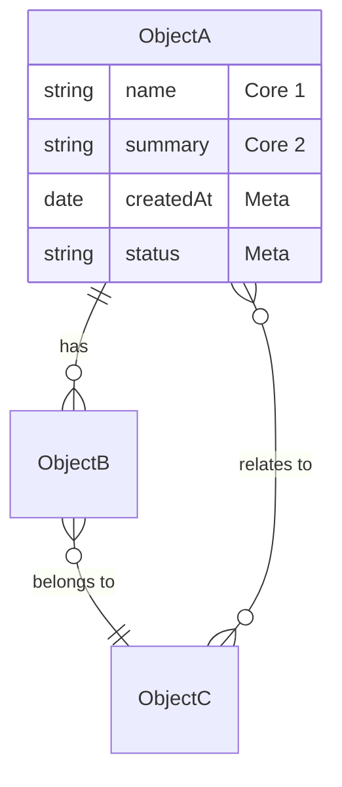
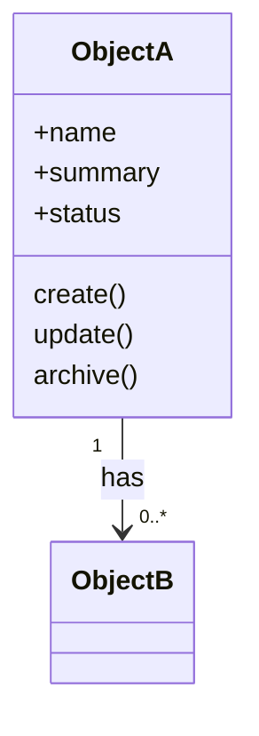

# Object Map: [Project / Domain]

Confirmed after Gate 2. This is the system model, not a sitemap.

## Diagram

Cardinality notation: `||` exactly one, `o|` zero or one, `}o` zero or many, `}|` one or many.

## Optional: Class Diagram View

## Summary Table

| Object | Definition | Nested in | Key relationships | Top 3 attributes | Key CTAs |
|---|---|---|---|---|---|
| | | | | | |
